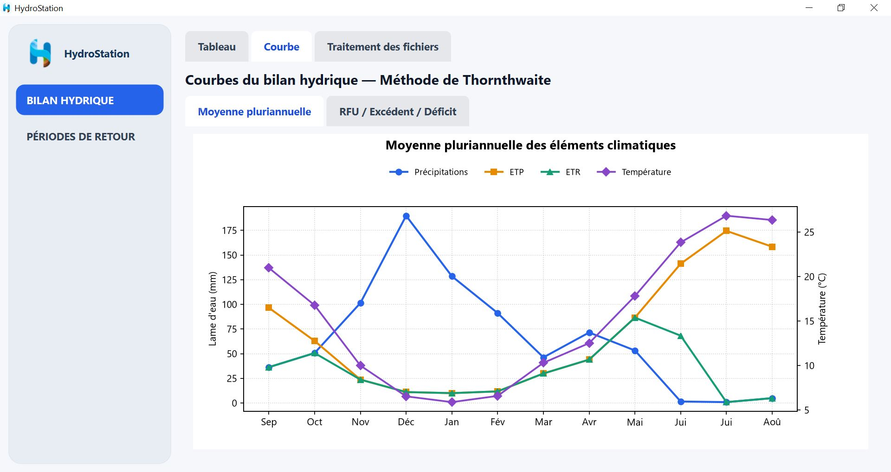
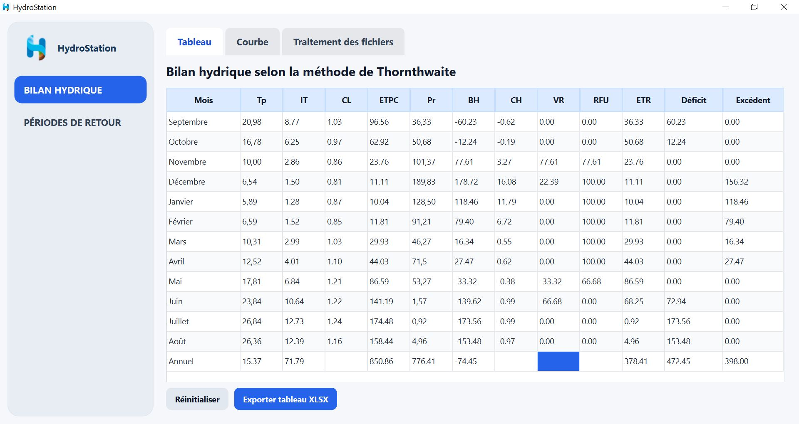
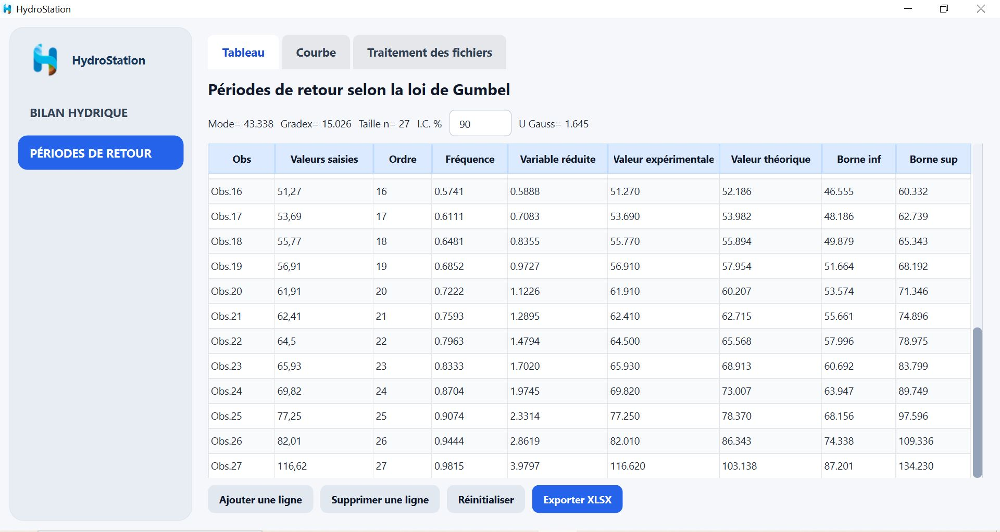

<p align="center">
  
</p>

<h1 align="center">HydroStation</h1>

<p align="center">
  A desktop application for hydrological analysis using the Thornthwaite water-balance method and Gumbel frequency analysis.
</p>

## Features

- **Water balance — Thornthwaite:** calculates ETp, water balance, RFU, actual evapotranspiration, deficit and surplus.
- **Return periods — Gumbel:** calculates statistical parameters, experimental and theoretical values, and confidence limits.
- **Batch processing:** processes individual files or folders and supports station matching.
- **Tables and charts:** view results and export tables to Excel (`.xlsx`).
- **Input formats:** `.xlsx`, `.xls`, `.xlsm`, `.xlsb`, `.ods`, `.csv`, `.txt` and `.tsv`.

## Screenshots

### Thornthwaite water-balance table



### Water-balance curves



### Gumbel return-period analysis



## Installation

**Windows:** run `Setup.bat` and follow the installation steps. The installer prepares the Python environment, installs the required libraries and creates a HydroStation shortcut.

## Run from source

Python 3.10–3.13 (64-bit) is supported. From the project folder, install the dependencies and launch the application:

```bash
python -m pip install "PySide6>=6.9,<7" "matplotlib>=3.9,<4" "pandas>=2.2,<3" "openpyxl>=3.1,<4" "xlrd>=2.0,<3" "odfpy>=1.4,<2" "pyxlsb>=1.0,<2" "pywin32>=306"
python main.py
```

## Built with

Python · PySide6 · Pandas · Matplotlib · OpenPyXL
